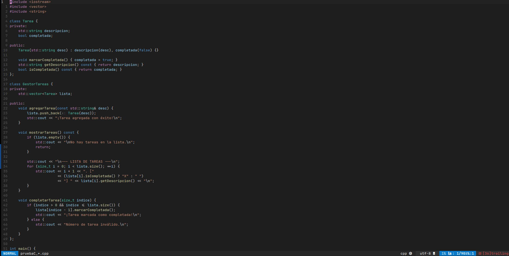

# Vim Portable



Configuración **portable y reproducible** de Vim, pensada para usar la **misma experiencia de edición** en cualquier computadora sin modificar el Vim del sistema.

Este repositorio está orientado al **desarrollo de software de propósito general**. La configuración puede utilizarse con diferentes lenguajes de programación mediante CoC y los servidores LSP correspondientes.

Actualmente, el soporte más completo y probado está configurado para **C/C++ mediante coc-clangd y clangd**. C/C++ se usa en esta guía **como ejemplo** de cómo instalar el soporte de un lenguaje; para otros lenguajes se siguen los mismos pasos (ver [Agregar otro lenguaje](#agregar-otro-lenguaje)).

Este repositorio permite clonar, ejecutar y trabajar con Vim usando:

- configuración propia
- plugins gestionados con vim-plug
- soporte LSP/autocompletado con CoC
- arquitectura extensible para diferentes lenguajes
- integración con Git desde Vim

> **Nota:** Portable significa que la configuración de Vim se mantiene dentro
> del repositorio y puede trasladarse entre equipos sin depender de `~/.vim`
> o `~/.vimrc`. Lo que **no** viaja con el repositorio son las herramientas del
> sistema (Vim, Node.js, fuente, servidores de lenguaje). Se instalan **una vez
> por equipo** siguiendo la [Instalación paso a paso](#instalación-paso-a-paso).

---

## Objetivo del proyecto

El objetivo de este repositorio es:

- Tener una configuración de Vim **portable**
- No depender de `~/.vim` ni `~/.vimrc`
- Usar Vim como editor principal para desarrollo de software
- Incorporar herramientas de IDE sin perder la filosofía de edición de Vim
- Poder usar Vim en cualquier equipo con solo clonar el repo
- Mantener un entorno limpio y controlado
- Extender el entorno progresivamente según los lenguajes y tecnologías utilizadas

---

## ¿Qué incluye esta configuración?

### Editor y apariencia

- Tema principal **Code Dark**.
- Tema alternativo **Monokai**.
- Barra de estado con **vim-airline**.
- Iconos mediante **vim-devicons**.
- Números de línea absolutos y relativos.
- Resaltado de la línea actual.
- Soporte **True Color** para utilizar los colores RGB del tema.

### Herramientas de desarrollo

- Autocompletado y soporte LSP mediante **coc.nvim**.
- Arquitectura extensible para múltiples lenguajes.
- Soporte C/C++ preconfigurado mediante **coc-clangd + clangd**.
- Resaltado semántico para C/C++ integrado con la paleta **Code Dark**.
- Explorador de archivos con **NERDTree**.
- Búsqueda rápida mediante **fzf** y **fzf.vim**.
- Terminal integrada con **vim-floaterm**.
- Integración con Git mediante **vim-fugitive**.
- Comentado rápido de código con **NERDCommenter**.

---

## Estructura del proyecto

```text
vim-portable/
├── vim.sh                 # Script para lanzar Vim portable
├── vimrc                  # Configuración principal de Vim
├── coc-settings.json      # Configuración de CoC y resaltado semántico
├── .gitignore
├── README.md
├── assets/                # Imágenes y recursos del repositorio
└── vim/
    ├── autoload/
    │   └── plug.vim       # Gestor de plugins vim-plug
    └── plugged/           # Plugins instalados localmente (se descargan en el Paso 7)
```

Algunas herramientas opcionales pueden generar directorios locales adicionales. Estos archivos no forman parte necesariamente de la configuración que debe versionarse en Git.

---

## Sistemas operativos compatibles

Esta guía está escrita para:

- **Ubuntu** (20.04 o superior)
- **Debian** (11 o superior)
- **WSL2** con Ubuntu o Debian (Windows 10/11)

Si usas Windows, **no uses el cmd ni PowerShell directamente**: instala WSL2 (en PowerShell como administrador: `wsl --install`), abre Ubuntu y sigue esta guía dentro de esa terminal.

> En WSL clona siempre el repositorio **dentro del sistema Linux** (por ejemplo en `~/`), nunca en `/mnt/c/...`.

---

## Cómo funciona (léelo antes de instalar)

Para que todo funcione hacen falta cuatro capas. **Solo la capa 2 viene en este repositorio**; las demás se instalan en cada equipo.

```text
┌────────────────────────────────────────────────────────────────┐
│ 1. SISTEMA (se instala con apt / nvm)                          │
│    Vim 9+, git, curl, Node.js + npm, Nerd Font, terminal       │
├────────────────────────────────────────────────────────────────┤
│ 2. ESTE REPOSITORIO (viene al clonar)                          │
│    vim.sh, vimrc, coc-settings.json, plug.vim                  │
├────────────────────────────────────────────────────────────────┤
│ 3. PLUGINS (se descargan con :PlugInstall)                     │
│    coc.nvim, NERDTree, fzf, airline, temas…                    │
├────────────────────────────────────────────────────────────────┤
│ 4. SOPORTE POR LENGUAJE (uno por cada lenguaje que uses)       │
│    servidor LSP en el sistema  +  extensión de CoC             │
│    Ejemplo C/C++:  clangd (apt)  +  coc-clangd (CocInstall)    │
└────────────────────────────────────────────────────────────────┘
```

---

## Instalación paso a paso

Cada paso termina con una sección **Verifica**. **No pases al siguiente paso si el resultado no coincide**; revisa la [Solución de problemas](#solución-de-problemas).

Los comandos se ejecutan en la terminal. Si una línea empieza con `$`, no copies ese símbolo.

### Paso 1 · Herramientas base del sistema

```bash
sudo apt update
sudo apt install -y git curl unzip ca-certificates vim ripgrep
```

> Instala el paquete `vim`, **no** `vim-tiny`. `vim-tiny` es una versión reducida que no sirve para esta configuración. `ripgrep` es opcional: lo usa el comando `:Rg` para buscar texto en los archivos.

#### Verifica el paso 1

```bash
vim --version | head -n 1
```

Debe decir `VIM - Vi IMproved 9.0` o superior. Y además:

```bash
vim --version | grep -oE '\+(job|channel|timers|textprop)'
```

Deben aparecer las **4 líneas**: `+job`, `+channel`, `+timers`, `+textprop`.

Qué trae cada sistema por defecto:

| Sistema | Vim en `apt` | ¿Sirve? |
|---|---|---|
| Ubuntu 24.04+ | 9.1 | Sí |
| Debian 12+ | 9.0 | Sí |
| Ubuntu 20.04 / 22.04 | 8.2 | No, ve al Paso 2 |
| Debian 11 | 8.2 | No, ve al Paso 2 |

Si tu versión es suficiente, **salta al Paso 3**.

---

### Paso 2 · (Solo si tu Vim es menor a 9.0.0438) Compilar un Vim reciente

Esto instala un Vim nuevo **en tu carpeta de usuario**, sin `sudo` y sin tocar el Vim del sistema.

```bash
sudo apt install -y build-essential libncurses-dev
git clone --depth 1 https://github.com/vim/vim.git /tmp/vim-src
cd /tmp/vim-src
./configure --with-features=huge --prefix="$HOME/.local"
make -j"$(nproc)"
make install
cd ~
```

Haz que el sistema encuentre ese Vim primero:

```bash
mkdir -p ~/.local/bin
echo 'export PATH="$HOME/.local/bin:$PATH"' >> ~/.bashrc
source ~/.bashrc
```

(Si usas zsh, reemplaza `~/.bashrc` por `~/.zshrc`.)

#### Verifica el paso 2

```bash
which vim
vim --version | head -n 1
```

`which vim` debe mostrar una ruta dentro de tu carpeta (`/home/tu-usuario/.local/bin/vim`) y la versión debe ser 9.0 o superior.

---

### Paso 3 · Node.js (20.19 o superior) y npm

CoC necesita Node.js, y **npm** (viene con Node) instala las extensiones de CoC. **No uses `sudo apt install nodejs`**: la versión de los repositorios de Ubuntu/Debian es demasiado antigua.

Primero revisa si ya tienes una versión válida:

```bash
node --version
npm --version
```

Si `node` muestra `v20.19.0` o mayor, **salta al Paso 4**. Si no existe o es menor, instala con **nvm** (no requiere `sudo`):

```bash
curl -o- https://raw.githubusercontent.com/nvm-sh/nvm/v0.40.3/install.sh | bash
```

Cierra la terminal y **abre una nueva** (o ejecuta `source ~/.bashrc`). Después:

```bash
nvm install 22
```

#### Verifica el paso 3

```bash
node --version
npm --version
```

`node` debe mostrar `v20.19.0` o mayor (por ejemplo `v22.x.x`) y `npm` debe mostrar un número de versión.

> **Importante:** abre siempre Vim desde una terminal en la que `node --version` funcione, porque Vim hereda el `PATH` de esa terminal.

---

### Paso 4 · Nerd Font y True Color

**4.1 Instalar la fuente**

```bash
mkdir -p ~/.local/share/fonts
curl -fLo /tmp/JetBrainsMono.zip https://github.com/ryanoasis/nerd-fonts/releases/latest/download/JetBrainsMono.zip
unzip -o /tmp/JetBrainsMono.zip -d ~/.local/share/fonts/JetBrainsMono
fc-cache -fv
```

> **Si usas WSL:** la fuente se instala **en Windows**, no en Linux. Descarga *JetBrainsMono* desde <https://www.nerdfonts.com/font-downloads>, descomprime el `.zip`, selecciona los archivos `.ttf`, clic derecho → *Instalar*.

**4.2 Elegir la fuente en tu terminal** (este paso es manual)

- **Ubuntu/Debian con interfaz gráfica:** Preferencias de la terminal → Perfil → Fuente personalizada → `JetBrainsMono Nerd Font`.
- **WSL con Windows Terminal:** Configuración → tu perfil de Ubuntu → Apariencia → Tipo de fuente → `JetBrainsMono Nerd Font`.

**4.3 Comprobar True Color**

```bash
printf '\x1b[38;2;255;100;0mTRUECOLOR\x1b[0m\n'
```

Debe verse la palabra **TRUECOLOR en color naranja**. Si sale en otro color o con el color normal del texto, tu terminal no soporta True Color. Windows Terminal, GNOME Terminal y Konsole lo soportan.

Si naranja se ve bien, **sigue con el Paso 5**.

> **Solo si usas tmux** (si no sabes qué es, ignora esto): estas dos líneas **no se escriben en la terminal**, se pegan dentro del archivo `~/.tmux.conf`:
>
> ```text
> set -g default-terminal "tmux-256color"
> set -as terminal-features ",*:RGB"
> ```

#### Verifica el paso 4

```bash
echo -e "\uf015  \uf07b  \ue725"
```

Debes ver **tres iconos** (casa, carpeta, rama). Si ves cuadros, la terminal no está usando la Nerd Font (repite 4.2).

---

### Paso 5 · Clonar el repositorio

```bash
git clone https://github.com/Edavila2002/vim-portable.git ~/vim-portable
cd ~/vim-portable
```

#### Verifica el paso 5

```bash
ls
ls vim/autoload/plug.vim
```

Debes ver `vim.sh`, `vimrc`, `coc-settings.json` y el archivo `plug.vim`.

Si `plug.vim` **no existe**, descárgalo:

```bash
curl -fLo vim/autoload/plug.vim --create-dirs \
  https://raw.githubusercontent.com/junegunn/vim-plug/master/plug.vim
```

---

### Paso 6 · Permisos del script

```bash
chmod +x vim.sh
./vim.sh --version | head -n 1
```

(Ejecuta `./vim.sh` desde la carpeta `vim-portable`, o usa la ruta completa `~/vim-portable/vim.sh`.)

#### Verifica el paso 6

Debe mostrarse `VIM - Vi IMproved 9.x`. Si aparece `bad interpreter: /bin/bash^M`, mira la [Solución de problemas](#solución-de-problemas).

---

### Paso 7 · Instalar los plugins

Este comando descarga todos los plugins **sin abrir la interfaz** y se cierra solo. Necesita internet y puede tardar uno o dos minutos:

```bash
./vim.sh +'PlugInstall --sync' +qall
```

Es normal ver mensajes de error sobre un esquema de color que no se encuentra: aún no estaban instalados los plugins. Si aparece `Press ENTER or type command to continue`, presiona **Enter**.

#### Verifica el paso 7

```bash
./vim.sh
```

Esta vez **no deben aparecer errores**. Dentro de Vim escribe:

```vim
:PlugStatus
```

Todos los plugins deben decir **OK**. Sal con `:q` y Enter.

---

### Paso 8 · Soporte para un lenguaje (ejemplo: C/C++)

Cada lenguaje necesita **dos piezas**: un **servidor LSP en el sistema** y su **extensión de CoC**. Estos son los pasos para C/C++, el lenguaje preconfigurado y probado.

**8.1 Instalar el compilador y el servidor `clangd` en el sistema**

```bash
sudo apt install -y build-essential clangd
```

Comprueba:

```bash
clangd --version
gcc --version | head -n 1
```

> Si `apt` no encuentra `clangd`, prueba `sudo apt install clangd-14` (o la versión que ofrezca tu distribución). Como alternativa, una vez instalada la extensión (8.2) puedes ejecutar dentro de Vim `:CocCommand clangd.install`.

**8.2 Instalar la extensión de CoC** (sin abrir la interfaz)

```bash
./vim.sh +'CocInstall -sync coc-clangd' +qall
```

#### Verifica el paso 8

Abre Vim y escribe:

```vim
:CocList extensions
```

Debe aparecer `coc-clangd`.

---

### Paso 9 · Prueba final

Desde la carpeta del repositorio (`~/vim-portable`):

```bash
cd ~/vim-portable
cat > prueba.c << 'EOF'
#include <stdio.h>

int main(void) {
    printf("hola\n");
    return 0;
}
EOF
./vim.sh prueba.c
```

Dentro de Vim comprueba:

1. Se ven los colores y la barra de estado con iconos.
2. `:CocList services` muestra `clangd` en ejecución.
3. Coloca el cursor sobre `printf` (moviéndote con `h j k l`) y presiona `K`: debe mostrar su documentación.

Si todo coincide, la instalación está completa.

Para terminar, sal de Vim con `:q` y borra el archivo de prueba para que no quede en el repositorio:

```bash
rm prueba.c
```

> **Proyectos con varios archivos:** `clangd` necesita saber cómo se compila tu proyecto. Con CMake: `cmake -S . -B build -DCMAKE_EXPORT_COMPILE_COMMANDS=ON` y luego `ln -s build/compile_commands.json .`. Con Make: `sudo apt install bear` y `bear -- make`. Para pruebas sencillas basta un archivo `compile_flags.txt` con una opción por línea (por ejemplo `-Wall`).

---

### Paso 10 · (Opcional) Usar Vim Portable desde cualquier carpeta

```bash
mkdir -p ~/.local/bin
ln -sf ~/vim-portable/vim.sh ~/.local/bin/vim.sh
```

Comprueba que `~/.local/bin` esté en el `PATH`:

```bash
echo "$PATH" | tr ':' '\n' | grep '.local/bin'
```

Si **no aparece nada**:

```bash
echo 'export PATH="$HOME/.local/bin:$PATH"' >> ~/.bashrc
source ~/.bashrc
```

Ahora puedes usar, desde cualquier carpeta:

```bash
vim.sh archivo.c
vim.sh .
```

---

## Agregar otro lenguaje

Vim Portable **no está limitado a C/C++**. El proceso es siempre el mismo cuatro pasos, y el Paso 8 es el ejemplo:

```text
1. Instalar en el sistema el compilador/intérprete del lenguaje
2. Instalar en el sistema el servidor LSP del lenguaje
3. Instalar la extensión de CoC correspondiente
4. Verificar con :CocList services
```

| Lenguaje | Instalar en el sistema | Extensión de CoC |
|---|---|---|
| C / C++ | `sudo apt install build-essential clangd` | `coc-clangd` |
| Python | `sudo apt install python3` | `coc-pyright` |
| JavaScript / TypeScript | (Node.js del Paso 3) | `coc-tsserver` |
| HTML / CSS / JSON | (Node.js del Paso 3) | `coc-html`, `coc-css`, `coc-json` |
| Bash | (Node.js del Paso 3) | `coc-sh` |

Instalación de la extensión, siempre igual:

```bash
./vim.sh +'CocInstall -sync NOMBRE-DE-LA-EXTENSION' +qall
```

> Algunas extensiones traen su propio servidor y otras necesitan que lo instales aparte. Revisa la documentación de la extensión. Lista general: <https://github.com/neoclide/coc.nvim/wiki/Using-coc-extensions>. Solo C/C++ está probado en este repositorio.

---

## Soporte LSP con CoC

Este proyecto utiliza **coc.nvim** como cliente LSP.

Esto permite incorporar funcionalidades como:

- Autocompletado.
- Navegación hacia definiciones.
- Referencias.
- Implementaciones.
- Información de tipos.
- Diagnósticos.
- Renombrado de símbolos.
- Documentación contextual.
- Resaltado semántico cuando el servidor LSP lo soporta.

Cada lenguaje puede necesitar su propia extensión o servidor LSP.

### C y C++

Actualmente C/C++ es el entorno LSP preconfigurado y probado dentro del proyecto:

```text
Vim
 └── coc.nvim
      └── coc-clangd
           └── clangd
```

---

## Resaltado semántico en C/C++

La configuración utiliza los **Semantic Tokens** proporcionados por `clangd` a través de CoC.

Esta funcionalidad se encuentra habilitada en `coc-settings.json`:

```json
{
  "semanticTokens.enable": true
}
```

El `vimrc` enlaza los principales tokens semánticos con la paleta Standard de **vim-code-dark**.

Esto permite diferenciar visualmente elementos como:

- Variables y parámetros → **Light Blue**
- Funciones → **Yellow**
- Tipos definidos por el usuario → **Blue Green**
- Macros → **Pink**
- Strings → **Orange**
- Comentarios → **Green**

La combinación utilizada actualmente es:

```text
clangd
   ↓
Semantic Tokens
   ↓
CoC
   ↓
vim-code-dark
```

---

## Autocompletado

CoC muestra automáticamente un menú cuando existen sugerencias disponibles.

```text
Escribir código
      ↓
Aparece el menú de sugerencias
      ↓
↑ / ↓ para seleccionar
      ↓
Enter para aceptar
```

### Controles

| Tecla | Acción |
|---|---|
| `↑` | Opción anterior |
| `↓` | Opción siguiente |
| `Enter` | Aceptar sugerencia |
| `Tab` | Indentación normal |

Las flechas permanecen disponibles en **modo Insert** para interactuar cómodamente con el menú de autocompletado.

---

## Navegación LSP

| Comando | Acción |
|---|---|
| `gd` | Ir a la definición |
| `gy` | Ir a la definición del tipo |
| `gi` | Ir a la implementación |
| `gr` | Mostrar referencias |
| `K` | Mostrar documentación |
| `[g` | Ir al diagnóstico anterior |
| `]g` | Ir al diagnóstico siguiente |
| `<leader>rn` | Renombrar símbolo |

> La tecla `<leader>` por defecto en Vim es `\`, así que renombrar sería `\rn`.

Por ejemplo, colocando el cursor sobre una función, `gd` permite saltar directamente a su definición.

---

## Navegación entre saltos

Vim mantiene un historial de los lugares visitados. Después de usar `gd` puedes regresar con `Ctrl + o` y avanzar con `Ctrl + i`.

```text
main.c
  │
  │ gd
  ▼
definición
  │
  │ Ctrl+o
  ▼
main.c
```

---

## Números de línea relativos

```vim
set number
set relativenumber
```

La línea actual muestra su número real, mientras que las demás indican su distancia respecto al cursor. Esto facilita movimientos como `5j` (bajar cinco líneas) o `8k` (subir ocho).

---

## Movimiento con H J K L

Las flechas están desactivadas en los modos **Normal** y **Visual** con el objetivo de fomentar el aprendizaje de los movimientos de Vim:

```text
h → izquierda
j → abajo
k → arriba
l → derecha
```

En modo **Insert** las flechas permanecen habilitadas para utilizar el menú de autocompletado.

---

## Primeros pasos si nunca usaste Vim

Vim tiene **modos**. Al abrir un archivo estás en modo **Normal**: las teclas ejecutan comandos, no escriben texto.

| Quiero… | Teclas |
|---|---|
| Escribir texto | `i` (modo Insert) |
| Volver a modo Normal | `Esc` |
| Guardar | `:w` + Enter |
| Salir | `:q` + Enter |
| Guardar y salir | `:wq` + Enter |
| Salir sin guardar | `:q!` + Enter |

Para practicar, ejecuta `vimtutor` en la terminal (tutorial interactivo de unos 30 minutos).

---

## Uso diario

Abrir un archivo:

```bash
./vim.sh archivo.c
```

Iniciar Vim sin especificar un archivo:

```bash
./vim.sh
```

Desde allí puedes utilizar NERDTree, fzf y las demás herramientas instaladas para navegar por el proyecto.

---

## Git dentro de Vim

La configuración incluye **vim-fugitive**, lo que permite ejecutar operaciones Git directamente desde Vim:

```vim
:Git status
:Git add archivo
:Git commit
:Git push
```

Git también puede seguir utilizándose normalmente desde la terminal.

---

## Inteligencia Artificial opcional

El proyecto contempla integración con **Codeium/Windsurf**, pero actualmente se encuentra desactivada por defecto.

Para volver a utilizarla es necesario habilitar nuevamente el plugin y su configuración en el `vimrc`, instalarlo con `:PlugInstall` y realizar la autenticación correspondiente. La IA es una herramienta adicional del entorno y no una dependencia obligatoria.

---

## Solución de problemas

| Síntoma | Solución |
|---|---|
| `Permission denied` al ejecutar `./vim.sh` | `chmod +x vim.sh` |
| `bad interpreter: /bin/bash^M` | `sed -i 's/\r$//' vim.sh`. Mejor: clona dentro de WSL, no en `/mnt/c` |
| `vim: command not found` | Pasos 1 y 2 |
| `E492: Not an editor command: PlugInstall` | Comando de contingencia del Paso 5 |
| `E185: Cannot find color scheme ...` al abrir | Paso 7 |
| Errores de funciones o plugins que no cargan | Pasos 1 y 2 |
| Iconos como `□` o `?` | Paso 4 (en WSL, instala la fuente en Windows) |
| Colores apagados o incorrectos | Paso 4.3 |
| `[coc.nvim] Node.js version ... is too old` | Paso 3 |
| `node is not executable` / `node: command not found` dentro de Vim | Abre Vim desde una terminal donde `node --version` funcione |
| `build/index.js not found` (coc.nvim) | `cd ~/vim-portable/vim/plugged/coc.nvim && npm ci` |
| `:CocInstall` falla con errores de `npm` | Paso 3 y comprueba tu conexión |
| `clangd: command not found` | Paso 8.1 |
| `'stdio.h' file not found` en el editor | `sudo apt install build-essential` y nota del Paso 9 |
| `:Files` o `:Rg` no funcionan | `:call fzf#install()` y `sudo apt install ripgrep` |

### Si nada de esto resuelve tu caso

Abre un *issue* en el repositorio e incluye:

- Tu sistema (Ubuntu/Debian/WSL) y su versión (`lsb_release -a`).
- La salida de `./vim.sh --version | head -n 1` y de `node --version`.
- El mensaje de error completo (dentro de Vim, `:messages` y `:CocInfo`).

---

## Actualizar y desinstalar

**Actualizar**

```bash
cd ~/vim-portable
git pull
./vim.sh +PlugUpdate +qall
```

**Desinstalar**

```bash
rm -rf ~/vim-portable
rm -f ~/.local/bin/vim.sh
```

CoC guarda por defecto sus extensiones **fuera del repositorio**, en `~/.config/coc`. Si no lo usas con otro Vim/Neovim, puedes eliminarlo:

```bash
rm -rf ~/.config/coc
```

Tu `~/.vimrc` y `~/.vim` originales nunca fueron modificados.

---

## Plugins utilizados

Este proyecto utiliza los siguientes plugins y herramientas open-source:

- **vim-plug** — Gestor de plugins
  https://github.com/junegunn/vim-plug

- **coc.nvim** — LSP y autocompletado
  https://github.com/neoclide/coc.nvim

- **NERDTree** — Explorador de archivos
  https://github.com/preservim/nerdtree

- **fzf** — Motor de búsqueda fuzzy
  https://github.com/junegunn/fzf

- **fzf.vim** — Integración de fzf con Vim
  https://github.com/junegunn/fzf.vim

- **vim-airline** — Barra de estado
  https://github.com/vim-airline/vim-airline

- **vim-code-dark** — Tema visual Code Dark
  https://github.com/tomasiser/vim-code-dark

- **vim-monokai** — Tema visual Monokai
  https://github.com/ku1ik/vim-monokai

- **NERDCommenter** — Comentado rápido de código
  https://github.com/preservim/nerdcommenter

- **vim-devicons** — Iconos para archivos
  https://github.com/ryanoasis/vim-devicons

- **vim-fugitive** — Integración con Git
  https://github.com/tpope/vim-fugitive

- **vim-floaterm** — Terminal flotante
  https://github.com/voldikss/vim-floaterm

### Integración opcional

- **Codeium/Windsurf** — Asistencia mediante Inteligencia Artificial.
  Actualmente desactivada por defecto.

---

## Evolución del proyecto

Esta configuración se desarrolla progresivamente. La idea no es instalar herramientas innecesarias, sino incorporar nuevas capacidades a medida que sean requeridas para el desarrollo de software.

Entre las áreas que pueden ampliarse posteriormente se encuentran:

- Desarrollo web.
- Herramientas avanzadas para C y C++.
- Desarrollo de videojuegos.
- Debugging.
- Testing.
- Formateo de código.
- Sistemas de compilación.
- Soporte LSP para nuevos lenguajes.
- Integración opcional con herramientas de Inteligencia Artificial.

---

## Licencia

Este proyecto contiene una configuración personal de Vim construida utilizando diferentes proyectos open-source.

Consulta las licencias individuales de cada plugin para conocer sus respectivos términos de uso.
